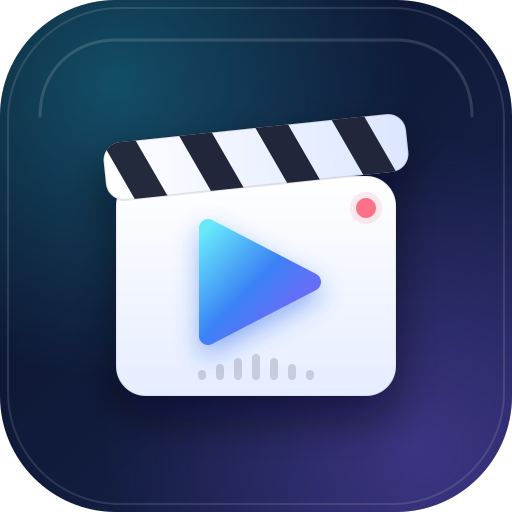

# 演示视频导演（demo-video-agent）



一个 Qoder 专家套件：先做分幕策划与旁白文稿，再走「TTS 配音 → 分幕录屏 → 音画合成 → 抽帧验收」的流水线。安装一次，对所有工作区生效。

套件按岗位组织为两个协作技能：`demo-video-storyboard` 负责讲什么、怎么分幕；`demo-video-production` 负责把文稿做成可验收的成片。源自真实产品演示片的工程实践（多幕、十余分钟成片），抽取为通用工具：声明式配置 + 可插拔场景函数，内置音画对齐、首帧遮蔽、挂起判据、多音字修正等踩坑经验。画面源支持三类幕：overlay 动画展示页、真实操作录屏、素材导入（App 真机录屏 / 实拍 / 渲染 / 截图序列）。

## 安装（Qoder 插件）

```bash
# 从本地目录安装到用户级（所有工作区可见）
qodercli plugin install --scope user /path/to/demo-video-agent

# 定位安装副本（版本目录随升级变化，不要写死；多市场并存时按版本号取最新）
DV_ROOT="$(ls -d "$HOME/.qoder/plugins/cache"/*/demo-video-agent/* 2>/dev/null | while read -r p; do echo "$(basename "$p") $p"; done | sort -V | tail -1 | cut -d' ' -f2-)"

# 安装插件依赖（playwright + 录屏 ffmpeg）并体检
node "$DV_ROOT/engine/cli.mjs" setup
node "$DV_ROOT/engine/cli.mjs" doctor
```

也可以直接在 Qoder 插件面板选择本地目录安装。

- 插件安装副本是**快照**：修改源码后重新执行 `plugin install` 即可覆盖同版本目录；重新安装会清空 `node_modules`，需要再跑一次 `setup`（约 1 秒，npm 有缓存）。
- 安装副本不带 `node_modules`；`setup` 或首次 `record` 会自动在插件目录安装 playwright，`DV_NO_AUTO_INSTALL=1` 可禁用。
- 可选：`node "$DV_ROOT/engine/cli.mjs" setup --link` 会在 `~/.local/bin` 生成 `demo-video` 启动器（自动指向最新安装版本）。

## 能力

- **分幕策划**：现场勘察、幕结构、narration.md 写作规范与时长预算，产出可直接制作的文稿与幕清单。
- **音频为主时间轴**：每幕时长取 TTS 实测值，视频不足 tpad 冻帧补齐、超长裁尾。
- **句级 VTT 对齐**：edge-tts 输出句级字幕，作为 `at()` / `--d` 的唯一校准源。
- **三类幕**：overlay 动画展示页（片头/片尾/导览）、真实操作幕（Playwright 编排）、素材幕（导入视频/截图）。
- **素材幕**：`scene.asset` 导入已有视频（mp4/webm/mov/gif，自动适配画幅 `fit: 'contain' | 'cover'`）或截图序列（按该幕 VTT 句首自动切换、末图撑到幕尾）——App 真机录屏、实拍、3D 渲染、设计稿直接配旁白出片；纯素材项目无需浏览器。
- **可彩排、可单幕重录**：`--dry` 每幕 8s 彩排、`--no-record` 只跑操作链、`--scenes` 指定幕。
- **抽帧验收**：`frames --scene m1 --at 5,30` 按幕内相对时间导出 PNG。
- **多音字修正**：内置读音词典（命令行 / 重新 / 会计 / 角色…）自动同音替换，字幕按位置还原；`tts.fixes` 可追加或关闭单条。
- **解说音色可选**：`tts.role`（新闻男声 / 阳光男声 / 沉稳男声 / 温暖女声…）或 `tts.gender`（male / female），单幕还能单独换人；`demo-video voices` 列清单。
- **多语言配音**：`tts.voice` 换成任意 edge-tts voice（中文/英文/日文…）。

## 环境要求

- Node.js ≥ 18
- ffmpeg / ffprobe（macOS `brew install ffmpeg`；Linux `apt install ffmpeg`；Windows `winget install Gyan.FFmpeg`）
- edge-tts（`pip install edge-tts`；脚本不在 PATH 时自动退回 `python -m edge_tts`）
- Chrome（`channel: 'chrome'`；未安装时自动回退 Playwright 内置 chromium）

## 快速开始（自带示例）

```bash
# 示例：两幕 overlay，约 12 秒成片（直连即可；网络受限时再加 DV_TTS_PROXY）
node "$DV_ROOT/engine/cli.mjs" all --config "$DV_ROOT/examples/hello-video/demo-video.config.mjs"

# 需要代理时：DV_TTS_PROXY=http://127.0.0.1:7890 node "$DV_ROOT/engine/cli.mjs" ...

# 产物
#   examples/hello-video/out/hello-demo.mp4
#   examples/hello-video/diag/frame-*.png
```

## 快速开始（素材导入）

```bash
# 示例：纯素材项目（截图序列按旁白句首切换 + 视频导入），约 17 秒成片，全程不经浏览器
node "$DV_ROOT/engine/cli.mjs" all --config "$DV_ROOT/examples/asset-demo/demo-video.config.mjs"

# 产物
#   examples/asset-demo/out/asset-demo.mp4（m00 三图随三句旁白切换；m01 视频短于旁白时冻帧补齐）
```

## 新建真实项目

```bash
node "$DV_ROOT/engine/cli.mjs" init ../my-demo
# 1) 编辑 my-demo/narration.md（每幕一行，如 "## m00 · 片头（约 12s）"）
# 2) 编辑 my-demo/overlay/*.html 与 demo-video.config.mjs（真实操作幕写 run(ctx)）

cd ../my-demo   # 之后可省略 --config：配置会从当前目录向上自动查找
node "$DV_ROOT/engine/cli.mjs" tts
node "$DV_ROOT/engine/cli.mjs" record --no-record   # 彩排
node "$DV_ROOT/engine/cli.mjs" record
node "$DV_ROOT/engine/cli.mjs" compose
node "$DV_ROOT/engine/cli.mjs" frames --at 3,8 --scene m00
```

## 在 Qoder 中使用

- 技能 `demo-video-storyboard`：分幕策划、旁白写作与交棒检查（规划阶段自动触发）。
- 技能 `demo-video-production`：完整制作工作流、校准公式、故障速查（制作阶段自动触发）。
- 子代理 `demo-video-director`：以导演视角编排两个技能，面向「给系统做一个演示视频」的端到端交付。
- 斜杠命令 `/demo-video`：`init / setup / doctor / tts / record / compose / frames / all` 的快捷入口。
- 详细操作手册：[skills/demo-video-production/references/operating-manual.md](skills/demo-video-production/references/operating-manual.md)（环境、示例验收、分幕、校准、录制、验收、排障）。

## 通用化设计

- **插件根自适应**：核心库由自身路径推导插件根，源码仓库与任意安装副本都可用；文档统一用 `DV_ROOT` 解析，不写死版本目录。
- **依赖自举**：缺少 playwright 时自动在插件目录安装；`setup` 统一处理 npm 依赖与录屏 ffmpeg。
- **配置发现**：`--config` > `DV_CONFIG` > 从当前目录向上查找 `demo-video.config.mjs`。
- **跨平台**：`which`/`where` 区分平台；edge-tts 覆盖 macOS/Linux/Windows 的 pip 用户目录，并支持 `python -m edge_tts` 兜底。
- **浏览器回退**：`channel: 'chrome'` 启动失败时自动回退 Playwright 内置 chromium。
- **多语言**：配音、语速走配置；内置多音字词典仅对中文音色生效，其他语言可用 `fixes` 自行扩展。

## 目录结构

```text
demo-video-agent/
  .qoder-plugin/plugin.json        # Qoder 插件清单
  qoder.md                         # 岗位指令（何时启用、交付标准、安全边界）
  commands/demo-video.md           # /demo-video 斜杠命令
  skills/
    demo-video-storyboard/
      SKILL.md                     # 分幕策划与旁白写作
    demo-video-production/
      SKILL.md                     # 制作工作流与硬性约束
      references/
        operating-manual.md        # 从零到交付的详细操作手册
        pipeline-reference.md      # 配置、CLI、ctx API、overlay 协议
        calibration-and-pitfalls.md # 音画校准与踩坑
  agents/demo-video-director.md    # 演示视频导演子代理
  engine/
    cli.mjs                        # 命令入口（setup/doctor/init/tts/record/compose/frames/all）
    lib/{deps,tts,record,compose,frames,narration,config,durations,util}.mjs
    lib/{asset,pronunciation,voices}.mjs # 素材幕、读音修正与音色预设
    templates/project/             # init 脚手架
  examples/hello-video/            # 最小可运行示例（overlay 幕）
  examples/asset-demo/             # 素材幕示例（截图序列 + 视频导入）
  LICENSE / CHANGELOG.md           # MIT 许可证与版本记录
```

## 网络访问与数据边界

| 行为 | 目标 | 说明 |
| --- | --- | --- |
| TTS 配音 | Microsoft Edge TTS（HTTPS） | 仅发送旁白文本；网络受限时可用 `DV_TTS_PROXY` 走本地代理 |
| `setup` / 首次录屏 | npm registry 与 Playwright CDN | 安装 playwright 与录屏 ffmpeg；`DV_NO_AUTO_INSTALL=1` 可关闭自动安装 |
| 录屏 / 合成 / 抽帧 | 本机 | 不上传页面内容、截图或成片；无遥测 |

- 不收集账号、令牌或项目数据；示例与文稿只使用演示数据。
- 被测系统默认访问 `http://127.0.0.1:3000`，可在 `config.baseUrl` 改为其他地址。
- 外部命令通过显式参数调用（edge-tts / ffmpeg / npx），不下载或执行远程脚本。

## 许可证

MIT，见 [LICENSE](LICENSE)。版本变更见 [CHANGELOG.md](CHANGELOG.md)。

## 验证记录

- 0.4.0 素材幕：`examples/asset-demo` 两幕（截图序列 + 视频导入）全链路 16.8s 成片；三张截图严格按 VTT 句首（0 / 2.708s / 5.690s）切换，6s 视频素材冻帧补齐至 8.1s，doctor 显示 `2 幕（asset 2）`，纯素材项目跳过浏览器加载；`--dry` / `--no-record` 正确跳过素材幕。
- 离线校验：`validate_qoder_plugin.py` 对源码目录与 `dist/demo-video-agent-0.3.0.zip` 均输出 `OK: no issues found`；`qodercli plugin validate` 输出 `valid and ready to install`，组件为 skills(2) / agents(1) / commands(1)。
- 本地安装：`qodercli plugin install --scope user` → `demo-video-agent@local v0.3.0`；安装副本含两个技能、角色指令与 `/demo-video` 命令；发布包 139K / 79 个文件（不含 node_modules、音视频与示例产物）。
- 安装副本自举：在 `/tmp` 执行安装副本的 `record --dry`，自动安装 playwright（2 个包，248ms）并完成 m00 录制（8.0s / 0.7MB）；`doctor` 的 plugin / node 22 / ffmpeg / ffprobe / edge-tts / playwright / pw-ffmpeg 全绿。
- 源码彩排：`examples/hello-video` 两幕 `--dry` 各 8.0s，overlay 动画与首帧遮蔽正常。
- `init` 脚手架：生成 config / narration / overlay / .gitignore；`doctor --config` 识别 2 幕，`voice` 行为默认温暖女声。
- 完整成片：`examples/agent-intro` 七幕 117.45s（H.264 1920×1080 25fps + AAC），20 个抽帧点全部通过。

## 已知限制

- 真实操作幕需要针对被测系统编写 Playwright 场景函数，无法自动理解任意 UI；素材幕可覆盖「已有视频/截图」的场景（App 真机录屏、实拍、渲染等）。
- 素材幕导入视频时丢弃素材原声（合成层仅映射旁白音轨）；竖屏素材默认 contain 留黑边，可配 `fit: 'cover'` 裁切填满。
- 仅支持旁白音轨；不含背景音乐与系统声音采集。
- 字幕 VTT 用于校准与交付，不默认烧录进画面。
- 录屏依赖浏览器；CI 无桌面环境需虚拟显示（xvfb），并确保已安装 chromium 或 Chrome。
- 暗色大面积平坦渐变在 VP8 录屏后可能出现轻微块状伪影，合成会继承；缓解方式见 `calibration-and-pitfalls.md`「画面质量与编码伪影」。

## 来源

- 工程实践：源自真实产品演示片项目（narration → TTS → record → compose，包含片头、架构图导览、业务闭环与片尾等幕型）。
- 本仓库将其抽象为通用 CLI，并补充 overlay 模板、抽帧验收命令与 Qoder 专家套件包装。
